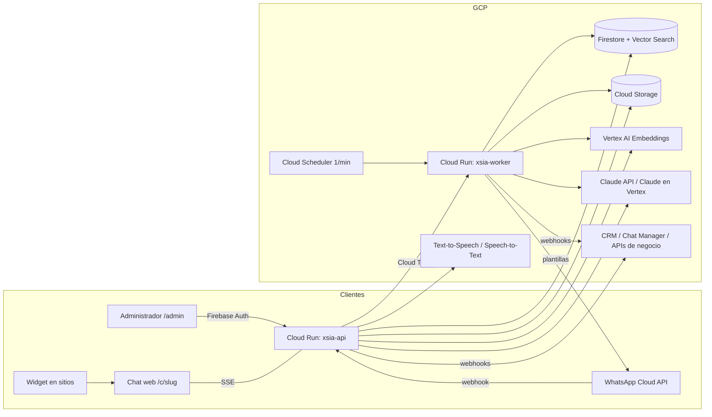

# XSIA Claude

Plataforma de atención conversacional con agentes de IA configurables. Incluye chat web, widget, WhatsApp y voz; RAG sobre documentos, CSV, sitios web e imágenes; herramientas de consulta (APIs); flujos de acción hacia el CRM, y el módulo **XSIA Recovery** para reactivar leads por WhatsApp.

- **IA:** Claude (Anthropic) para la conversación, el uso de herramientas, la lectura de PDFs e imágenes, la contextualización y el reordenamiento del RAG, y la evaluación de conversaciones.
- **Nube:** Google Cloud. Cloud Run, Firestore (con Vector Search), Cloud Storage, Cloud Tasks, Cloud Scheduler, Secret Manager, Vertex AI (embeddings), Text‑to‑Speech y Speech‑to‑Text. Firebase Hosting y Firebase Auth.



## Estructura

```
backend/            API y worker (Node 20 + TypeScript + Fastify), una imagen y dos servicios
  src/chat/         motor conversacional (ciclo agéntico de Claude con herramientas), prompts, sesiones, distribuidores
  src/rag/          ingesta (parseo, fragmentación, contextualización, embeddings), búsqueda vectorial, CSV, medios, crawler
  src/channels/     WhatsApp Cloud API (envío, webhook, enrutamiento de entrantes)
  src/recovery/     campañas, importación, programador de envíos, CRM, evaluación, reportes, supresión
  src/voice/        Text-to-Speech y Speech-to-Text
  src/routes/       API pública, admin, webhooks y tareas
frontend/           React + Vite: administrador, chat público y widget.js
infra/              setup.sh (aprovisionamiento) y deploy.sh (despliegues)
docs/               Arquitectura, modelo de datos, propuesta RAG y guía de despliegue
firebase.json       Hosting + reglas e índices de Firestore
cloudbuild.yaml     CI/CD opcional
```

## Cobertura del documento funcional

| Ámbito | Implementación |
|---|---|
| Chat web, contexto, Markdown/tablas, CTA, imágenes, captura progresiva, cierre | `chat/engine.ts`, `chat/prompt.ts`, `chat/tools.ts`, `frontend/pages/chat` |
| Voz (modos estable e inmediato, silencio, sensibilidad, protección de eco, respaldo a texto) | `frontend/pages/chat/useVoice.ts`, `voice/voice.ts` |
| WhatsApp (líneas, webhook, estados, plantillas, botones/listas, notas de voz, imágenes) | `channels/whatsapp.ts`, `/admin/lines` |
| Agentes: crear, duplicar, instrucciones principal/específica/etapas/herramientas/CTA, cualificación | `routes/admin/agents.ts`, `AgentEditor` |
| Documentos, CSV, librería de medios con vigencia, sitios web, referencias manuales | `rag/*`, `KnowledgeTabs` |
| Hasta 5 servicios externos y 4 flujos de acción, con etapas preparada/enviada/aceptada y sin duplicados | `chat/tools.ts`, `recovery/crm.ts`, `ToolsTabs` |
| Enlace directo, widget, multisitio, Chat Manager, directorio de distribuidores | `DistributionTabs`, `chat/dealers.ts` |
| Data y Dashboard (filtros por fecha, sitio, origen, campaña y canal; costo estimado; sincronización de Recovery) | `routes/admin/data.ts`, `DataTabs` |
| Recovery: 11 secciones, importación con mapeo (25,000 filas / 20 MB), elegibilidad, supresión, carga incremental | `recovery/*`, `CampaignEditor`, `RecoveryTabs` |
| Prevalidación, iniciar, pausar, reanudar, cancelar, ventanas, límites, estrategias de líneas, segundo intento | `recovery/campaigns.ts`, `recovery/scheduler.ts` |
| Atención Recovery: confirmar interés, distribuidores por ubicación del cliente, transferencia CRM idempotente, mensaje de atención aparte | `chat/prompt.ts`, `chat/tools.ts` |
| Evaluación (ánimo, intención, probabilidad, queja, opt‑out), reportes, exportación CSV, reintentos, reporte ejecutivo imprimible a PDF | `recovery/evaluation.ts`, `recovery/reports.ts` |

## Desarrollo local

```bash
# Backend (usa credenciales ADC: gcloud auth application-default login)
cd backend && cp .env.example .env && npm install
set -a && source .env && set +a && npm run dev        # ROLE=all, tareas en proceso

# Frontend
cd frontend && cp .env.example .env.local && npm install && npm run dev   # http://localhost:5173/admin
```

Datos de ejemplo: `cd backend && npm run seed:demo`. Con eso queda disponible el chat `/c/demo`.

## Despliegue en GCP

Consulta **[docs/DESPLIEGUE_GCP.md](docs/DESPLIEGUE_GCP.md)**. En resumen:

```bash
PROJECT_ID=mi-proyecto REGION=us-central1 ADMIN_EMAILS=yo@empresa.com ./infra/setup.sh
```
